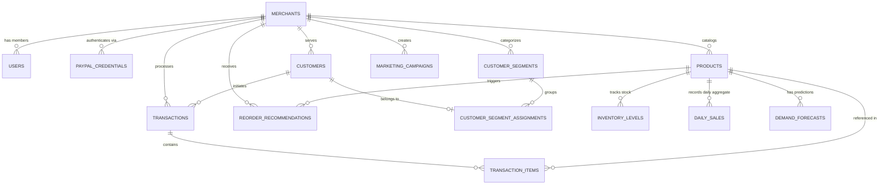

# DATABASE_DESIGN.md
## PayPal Merchant Growth Engine — Relational Database Schema Specification
### PayPal AI Hackathon 2026

---

## 1. Database Overview & Strategy

The application utilizes **PostgreSQL 16** with a strict relational schema managed via **SQLAlchemy ORM** and **Alembic** migrations. 

### Multi-Tenancy Guarantee
- Every operational table contains a non-nullable foreign key `merchant_id` pointing to `merchants.id`.
- Composite unique constraints and composite indexes prioritize `(merchant_id, ...)` to ensure that queries are inherently tenant-scoped and index-optimized.
- Foreign keys enforce `ON DELETE CASCADE` where appropriate for dependent transactional records.

---

## 2. Entity Relationship Diagram (ERD)



---

## 3. Detailed Table Definitions

### 3.1 `merchants`
Represents the business entity using the platform.
```sql
CREATE TABLE merchants (
    id VARCHAR(36) PRIMARY KEY, -- UUID v4
    business_name VARCHAR(255) NOT NULL,
    business_email VARCHAR(255) UNIQUE NOT NULL,
    currency VARCHAR(3) DEFAULT 'USD' NOT NULL,
    industry VARCHAR(100) DEFAULT 'Retail',
    connection_mode VARCHAR(20) DEFAULT 'SANDBOX' NOT NULL, -- 'SANDBOX' or 'MERCHANT_CONNECT'
    created_at TIMESTAMP WITH TIME ZONE DEFAULT CURRENT_TIMESTAMP NOT NULL,
    updated_at TIMESTAMP WITH TIME ZONE DEFAULT CURRENT_TIMESTAMP NOT NULL
);
CREATE INDEX idx_merchants_email ON merchants(business_email);
```

### 3.2 `users`
Merchant administrators and team operators.
```sql
CREATE TABLE users (
    id VARCHAR(36) PRIMARY KEY,
    merchant_id VARCHAR(36) NOT NULL REFERENCES merchants(id) ON DELETE CASCADE,
    email VARCHAR(255) UNIQUE NOT NULL,
    hashed_password VARCHAR(255) NOT NULL,
    full_name VARCHAR(150) NOT NULL,
    role VARCHAR(50) DEFAULT 'ADMIN' NOT NULL, -- 'ADMIN', 'ANALYST', 'VIEWER'
    is_active BOOLEAN DEFAULT TRUE NOT NULL,
    created_at TIMESTAMP WITH TIME ZONE DEFAULT CURRENT_TIMESTAMP NOT NULL,
    updated_at TIMESTAMP WITH TIME ZONE DEFAULT CURRENT_TIMESTAMP NOT NULL
);
CREATE INDEX idx_users_merchant ON users(merchant_id);
```

### 3.3 `paypal_credentials`
Stores encrypted PayPal Sandbox or Live API credentials per merchant.
```sql
CREATE TABLE paypal_credentials (
    id VARCHAR(36) PRIMARY KEY,
    merchant_id VARCHAR(36) UNIQUE NOT NULL REFERENCES merchants(id) ON DELETE CASCADE,
    client_id VARCHAR(255) NOT NULL,
    encrypted_client_secret TEXT NOT NULL,
    environment VARCHAR(20) DEFAULT 'SANDBOX' NOT NULL, -- 'SANDBOX' or 'LIVE'
    access_token TEXT,
    token_expires_at TIMESTAMP WITH TIME ZONE,
    webhook_id VARCHAR(100),
    is_connected BOOLEAN DEFAULT FALSE NOT NULL,
    last_synced_at TIMESTAMP WITH TIME ZONE,
    created_at TIMESTAMP WITH TIME ZONE DEFAULT CURRENT_TIMESTAMP NOT NULL,
    updated_at TIMESTAMP WITH TIME ZONE DEFAULT CURRENT_TIMESTAMP NOT NULL
);
CREATE INDEX idx_paypal_credentials_merchant ON paypal_credentials(merchant_id);
```

### 3.4 `customers`
Customers extracted from PayPal transactions or merchant records.
```sql
CREATE TABLE customers (
    id VARCHAR(36) PRIMARY KEY,
    merchant_id VARCHAR(36) NOT NULL REFERENCES merchants(id) ON DELETE CASCADE,
    paypal_payer_id VARCHAR(64), -- PayPal Payer ID if known
    email VARCHAR(255) NOT NULL,
    first_name VARCHAR(100),
    last_name VARCHAR(100),
    city VARCHAR(100),
    state VARCHAR(100),
    country VARCHAR(3) DEFAULT 'USA',
    total_spend NUMERIC(12, 2) DEFAULT 0.00 NOT NULL,
    transaction_count INT DEFAULT 0 NOT NULL,
    first_purchase_at TIMESTAMP WITH TIME ZONE,
    last_purchase_at TIMESTAMP WITH TIME ZONE,
    created_at TIMESTAMP WITH TIME ZONE DEFAULT CURRENT_TIMESTAMP NOT NULL,
    updated_at TIMESTAMP WITH TIME ZONE DEFAULT CURRENT_TIMESTAMP NOT NULL,
    CONSTRAINT uq_merchant_customer_email UNIQUE(merchant_id, email)
);
CREATE INDEX idx_customers_merchant_spend ON customers(merchant_id, total_spend DESC);
CREATE INDEX idx_customers_merchant_last_purchase ON customers(merchant_id, last_purchase_at);
```

### 3.5 `products`
The merchant's product catalog.
```sql
CREATE TABLE products (
    id VARCHAR(36) PRIMARY KEY,
    merchant_id VARCHAR(36) NOT NULL REFERENCES merchants(id) ON DELETE CASCADE,
    sku VARCHAR(64) NOT NULL,
    name VARCHAR(255) NOT NULL,
    category VARCHAR(100) DEFAULT 'General' NOT NULL,
    unit_cost NUMERIC(10, 2) DEFAULT 0.00 NOT NULL,
    unit_price NUMERIC(10, 2) NOT NULL,
    supplier_lead_time_days INT DEFAULT 7 NOT NULL,
    min_safety_stock INT DEFAULT 10 NOT NULL,
    is_active BOOLEAN DEFAULT TRUE NOT NULL,
    created_at TIMESTAMP WITH TIME ZONE DEFAULT CURRENT_TIMESTAMP NOT NULL,
    updated_at TIMESTAMP WITH TIME ZONE DEFAULT CURRENT_TIMESTAMP NOT NULL,
    CONSTRAINT uq_merchant_sku UNIQUE(merchant_id, sku)
);
CREATE INDEX idx_products_merchant_sku ON products(merchant_id, sku);
```

### 3.6 `inventory_levels`
Current on-hand, reserved, and incoming inventory counts.
```sql
CREATE TABLE inventory_levels (
    id VARCHAR(36) PRIMARY KEY,
    merchant_id VARCHAR(36) NOT NULL REFERENCES merchants(id) ON DELETE CASCADE,
    product_id VARCHAR(36) UNIQUE NOT NULL REFERENCES products(id) ON DELETE CASCADE,
    stock_on_hand INT NOT NULL DEFAULT 0,
    stock_reserved INT NOT NULL DEFAULT 0,
    stock_incoming INT NOT NULL DEFAULT 0,
    reorder_point INT NOT NULL DEFAULT 20,
    reorder_quantity INT NOT NULL DEFAULT 50,
    status VARCHAR(20) DEFAULT 'IN_STOCK' NOT NULL, -- 'IN_STOCK', 'LOW_STOCK', 'OUT_OF_STOCK'
    last_audited_at TIMESTAMP WITH TIME ZONE DEFAULT CURRENT_TIMESTAMP NOT NULL,
    updated_at TIMESTAMP WITH TIME ZONE DEFAULT CURRENT_TIMESTAMP NOT NULL
);
CREATE INDEX idx_inventory_merchant_status ON inventory_levels(merchant_id, status);
```

### 3.7 `transactions`
Synchronized PayPal transactions and merchant orders.
```sql
CREATE TABLE transactions (
    id VARCHAR(36) PRIMARY KEY,
    merchant_id VARCHAR(36) NOT NULL REFERENCES merchants(id) ON DELETE CASCADE,
    customer_id VARCHAR(36) REFERENCES customers(id) ON DELETE SET NULL,
    paypal_transaction_id VARCHAR(64), -- PayPal capture / order ID
    paypal_fee NUMERIC(10, 2) DEFAULT 0.00 NOT NULL,
    net_amount NUMERIC(12, 2) NOT NULL,
    gross_amount NUMERIC(12, 2) NOT NULL,
    currency VARCHAR(3) DEFAULT 'USD' NOT NULL,
    status VARCHAR(30) DEFAULT 'COMPLETED' NOT NULL, -- 'COMPLETED', 'PENDING', 'REFUNDED', 'DISPUTED'
    payment_source VARCHAR(30) DEFAULT 'PAYPAL_WALLET' NOT NULL, -- 'PAYPAL_WALLET', 'CARD', 'CRYPTO', 'REWARDS'
    transaction_date TIMESTAMP WITH TIME ZONE NOT NULL,
    is_cross_border BOOLEAN DEFAULT FALSE NOT NULL,
    raw_payload JSONB,
    created_at TIMESTAMP WITH TIME ZONE DEFAULT CURRENT_TIMESTAMP NOT NULL
);
CREATE INDEX idx_transactions_merchant_date ON transactions(merchant_id, transaction_date DESC);
CREATE INDEX idx_transactions_paypal_id ON transactions(paypal_transaction_id);
```

### 3.8 `transaction_items`
Line-item mapping linking transactions to catalog products when available.
```sql
CREATE TABLE transaction_items (
    id VARCHAR(36) PRIMARY KEY,
    transaction_id VARCHAR(36) NOT NULL REFERENCES transactions(id) ON DELETE CASCADE,
    product_id VARCHAR(36) REFERENCES products(id) ON DELETE SET NULL,
    quantity INT NOT NULL DEFAULT 1,
    unit_price NUMERIC(10, 2) NOT NULL,
    total_price NUMERIC(10, 2) NOT NULL
);
CREATE INDEX idx_trans_items_tx ON transaction_items(transaction_id);
CREATE INDEX idx_trans_items_product ON transaction_items(product_id);
```

### 3.9 `daily_sales`
Pre-aggregated daily sales time-series used by the forecasting engine.
```sql
CREATE TABLE daily_sales (
    id VARCHAR(36) PRIMARY KEY,
    merchant_id VARCHAR(36) NOT NULL REFERENCES merchants(id) ON DELETE CASCADE,
    product_id VARCHAR(36) NOT NULL REFERENCES products(id) ON DELETE CASCADE,
    sales_date DATE NOT NULL,
    units_sold INT DEFAULT 0 NOT NULL,
    revenue NUMERIC(12, 2) DEFAULT 0.00 NOT NULL,
    CONSTRAINT uq_merchant_product_sales_date UNIQUE(merchant_id, product_id, sales_date)
);
CREATE INDEX idx_daily_sales_lookup ON daily_sales(merchant_id, product_id, sales_date);
```

### 3.10 `customer_segments` & `customer_segment_assignments`
Stores RFM clusters and customer memberships.
```sql
CREATE TABLE customer_segments (
    id VARCHAR(36) PRIMARY KEY,
    merchant_id VARCHAR(36) NOT NULL REFERENCES merchants(id) ON DELETE CASCADE,
    name VARCHAR(100) NOT NULL, -- 'VIP', 'Loyal', 'Promising', 'New', 'At-Risk'
    description TEXT,
    customer_count INT DEFAULT 0 NOT NULL,
    revenue_percentage NUMERIC(5, 2) DEFAULT 0.00 NOT NULL,
    avg_order_value NUMERIC(10, 2) DEFAULT 0.00 NOT NULL,
    avg_recency_days INT DEFAULT 0 NOT NULL,
    created_at TIMESTAMP WITH TIME ZONE DEFAULT CURRENT_TIMESTAMP NOT NULL,
    updated_at TIMESTAMP WITH TIME ZONE DEFAULT CURRENT_TIMESTAMP NOT NULL
);

CREATE TABLE customer_segment_assignments (
    id VARCHAR(36) PRIMARY KEY,
    merchant_id VARCHAR(36) NOT NULL REFERENCES merchants(id) ON DELETE CASCADE,
    customer_id VARCHAR(36) NOT NULL REFERENCES customers(id) ON DELETE CASCADE,
    segment_id VARCHAR(36) NOT NULL REFERENCES customer_segments(id) ON DELETE CASCADE,
    recency_score INT NOT NULL,
    frequency_score INT NOT NULL,
    monetary_score INT NOT NULL,
    assigned_at TIMESTAMP WITH TIME ZONE DEFAULT CURRENT_TIMESTAMP NOT NULL,
    CONSTRAINT uq_customer_segment UNIQUE(customer_id)
);
```

### 3.11 `demand_forecasts`
Persisted time-series forecasts generated by the ML engine.
```sql
CREATE TABLE demand_forecasts (
    id VARCHAR(36) PRIMARY KEY,
    merchant_id VARCHAR(36) NOT NULL REFERENCES merchants(id) ON DELETE CASCADE,
    product_id VARCHAR(36) NOT NULL REFERENCES products(id) ON DELETE CASCADE,
    forecast_date DATE NOT NULL,
    predicted_demand NUMERIC(10, 2) NOT NULL,
    lower_bound NUMERIC(10, 2) NOT NULL,
    upper_bound NUMERIC(10, 2) NOT NULL,
    model_version VARCHAR(50) NOT NULL,
    confidence_score NUMERIC(5, 4) NOT NULL,
    created_at TIMESTAMP WITH TIME ZONE DEFAULT CURRENT_TIMESTAMP NOT NULL,
    CONSTRAINT uq_forecast_entry UNIQUE(merchant_id, product_id, forecast_date)
);
CREATE INDEX idx_forecast_lookup ON demand_forecasts(merchant_id, product_id, forecast_date);
```

### 3.12 `reorder_recommendations`
Actionable inventory reorder proposals generated by deterministic rules + forecast.
```sql
CREATE TABLE reorder_recommendations (
    id VARCHAR(36) PRIMARY KEY,
    merchant_id VARCHAR(36) NOT NULL REFERENCES merchants(id) ON DELETE CASCADE,
    product_id VARCHAR(36) NOT NULL REFERENCES products(id) ON DELETE CASCADE,
    recommended_quantity INT NOT NULL,
    reasoning TEXT NOT NULL,
    urgency VARCHAR(20) DEFAULT 'MEDIUM' NOT NULL, -- 'LOW', 'MEDIUM', 'HIGH', 'CRITICAL'
    status VARCHAR(20) DEFAULT 'PENDING' NOT NULL, -- 'PENDING', 'ORDERED', 'DISMISSED'
    created_at TIMESTAMP WITH TIME ZONE DEFAULT CURRENT_TIMESTAMP NOT NULL,
    resolved_at TIMESTAMP WITH TIME ZONE
);
```

### 3.13 `marketing_campaigns`
Campaign drafts and marketing strategies generated by the AI Copilot.
```sql
CREATE TABLE marketing_campaigns (
    id VARCHAR(36) PRIMARY KEY,
    merchant_id VARCHAR(36) NOT NULL REFERENCES merchants(id) ON DELETE CASCADE,
    target_segment_id VARCHAR(36) REFERENCES customer_segments(id) ON DELETE SET NULL,
    campaign_name VARCHAR(255) NOT NULL,
    channel VARCHAR(50) DEFAULT 'EMAIL' NOT NULL, -- 'EMAIL', 'SMS', 'PAYPAL_OFFER'
    headline VARCHAR(255) NOT NULL,
    body_text TEXT NOT NULL,
    suggested_discount_pct NUMERIC(5, 2) DEFAULT 0.00,
    status VARCHAR(20) DEFAULT 'DRAFT' NOT NULL, -- 'DRAFT', 'SCHEDULED', 'SENT'
    created_at TIMESTAMP WITH TIME ZONE DEFAULT CURRENT_TIMESTAMP NOT NULL
);
```
