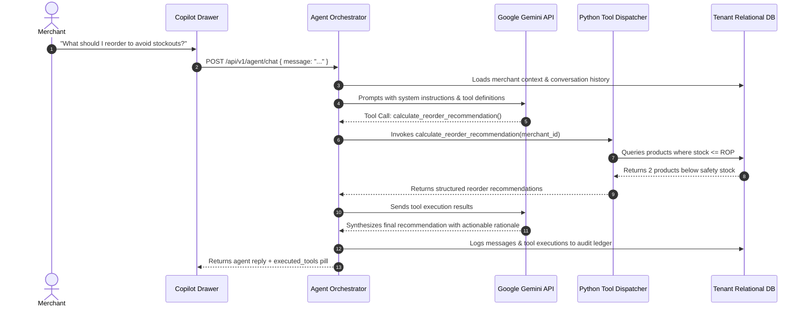

# Agentic AI & Copilot Orchestration

## 1. System Overview

The **PayPal AI Copilot** is an agentic decision-support engine. Unlike generic conversational chatbots, the Copilot cannot fabricate business statistics or hallucinate inventory balances. It operates strictly through **controlled backend tool execution** grounded in the merchant's persistent relational database.

---

## 2. Controlled Backend Tool Catalog

All tools are implemented in `backend/app/agent/tools.py` with strict `merchant_id` injection:

| Tool Name | Parameters | Purpose | Return Schema |
|---|---|---|---|
| `get_merchant_overview` | `merchant_id` | Queries gross revenue, transactions, customer count, low-stock items. | `{ total_balance, transaction_count, low_stock_count, customer_count }` |
| `get_inventory_status` | `merchant_id`, `category?`, `low_stock_only?` | Lists current stock levels, safety stocks, and supplier lead times. | `List[{ id, sku, name, current_stock, reorder_point, status }]` |
| `calculate_reorder_recommendation` | `merchant_id`, `product_id?` | Computes statistical $ROP$ and suggested reorder quantities. | `List[{ product_id, sku, recommended_qty, supplier_name, urgency }]` |
| `get_customer_segments` | `merchant_id` | Fetches active K-Means RFM cohorts, average spend, and descriptions. | `List[{ name, customer_count, percentage, avg_spend, description }]` |
| `generate_campaign_draft` | `merchant_id`, `target_segment`, `discount_pct?` | Generates marketing copy and promo code targeted to an RFM cohort. | `{ campaign_name, target_segment, promo_code, discount_pct, headline, copy }` |

---

## 3. Security Boundaries & Guardrails
1. **Zero Hallucination Guarantee**: The model is explicitly instructed never to invent numbers. If a tool returns no records, the model informs the user that no data is present.
2. **Strict Tenant Scoping**: The tool dispatcher injects the verified `merchant_id` from the user's authenticated session. The LLM has no ability to supply or modify `merchant_id`.
3. **Audit Ledger Logging**: Every tool execution is recorded in `agent_tool_executions` and `audit_logs` with parameters, execution timestamp, and outcome status.
4. **Deterministic Synthesis Fallback**: If an external Gemini API key is missing or unavailable, the orchestrator executes a rule-based deterministic dispatch to ensure continuous availability.
