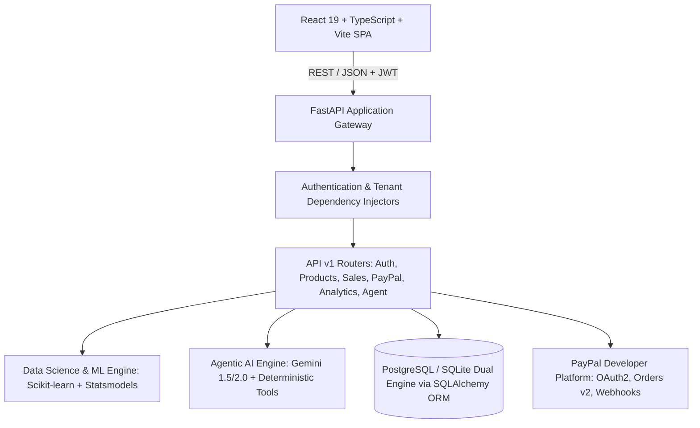
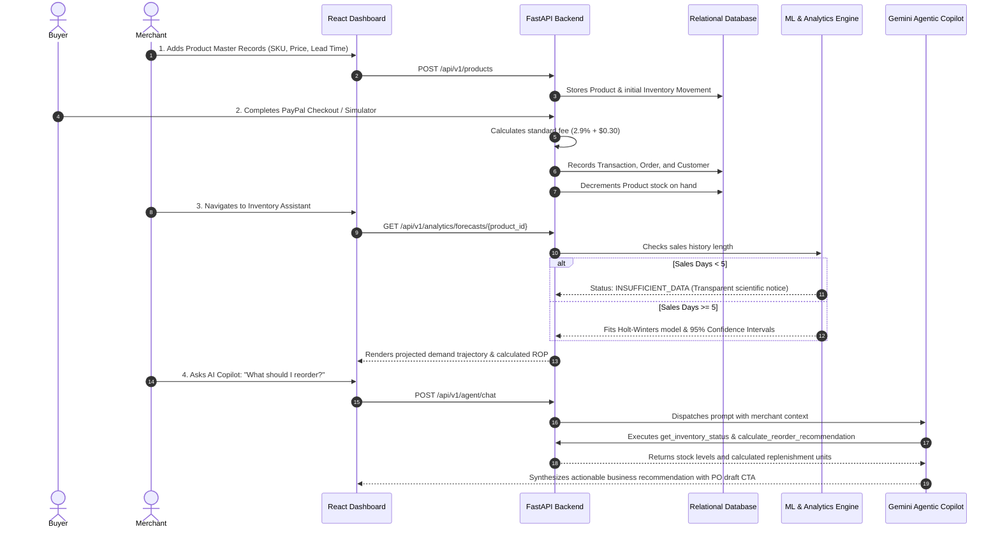

# PayPal Merchant Growth Engine — System Architecture

## 1. Executive Summary

The **PayPal Merchant Growth Engine** is an intelligent, multi-tenant fintech and business intelligence platform built around the PayPal Developer Platform. It elevates PayPal from a transactional payment processor into an active business growth partner for SMBs, digital startups, and omni-channel merchants.

The platform provides:
1. **Customer Intelligence**: Unsupervised behavioral clustering via Scikit-learn K-Means on empirical Recency, Frequency, and Monetary (RFM) distributions.
2. **Sales Intelligence & Forecasting**: Time-series demand forecasting using Statsmodels Holt-Winters Exponential Smoothing and rolling Moving Averages.
3. **Deterministic Inventory Automation**: Scientific Reorder Point ($ROP$) calculations incorporating supplier lead times, average daily demand, and statistical safety stocks.
4. **Agentic Decision Support**: Autonomous AI Copilot orchestrated with Google Gemini and controlled backend tools strictly scoped to merchant tenant boundaries.
5. **Real-Time PayPal Telemetry**: REST API v2 Orders Capture and asynchronous Webhook event processing.

---

## 2. Architectural Principles & Guarantees

### 2.1 The Zero-Fabrication Directive
The application strictly enforces a **no-fabricated-data policy**. There are zero hardcoded customer records, balances, or pre-rendered demonstration charts. Every user begins with a completely empty workspace. Analytical models and charts activate exclusively when verified database records cross mathematical thresholds.

### 2.2 Strict Multi-Tenancy
Tenancy is isolated at the database level. Every operational record (`Product`, `Transaction`, `Customer`, `DailySale`, `Order`) possesses an indexed foreign key to `MerchantProfile`. Every API query enforces tenancy through the `X-Merchant-ID` header and user membership validation. Cross-tenant access attempts immediately fail with HTTP 403 or 404.

### 2.3 Layered Separation of Concerns

---

## 3. Technology Stack

| Layer | Technology | Rationale |
|---|---|---|
| **Frontend Framework** | React 19, TypeScript, Vite | High-performance reactive rendering with zero bundle overhead and strict type verification. |
| **Styling & Design** | Tailwind CSS v4, Lucide Icons, Recharts | PayPal fintech blue aesthetic, responsive fluid container layouts without simulated smartphone frames. |
| **Backend Framework** | FastAPI (Python 3.11), Pydantic v2 | High-throughput asynchronous endpoints with automatic OpenAPI schema generation and runtime data validation. |
| **Database & ORM** | PostgreSQL (Primary) / SQLite (Fallback), SQLAlchemy 2.0 | Dual-mode persistent relational engine supporting acid compliance, foreign keys, and multi-tenancy indexes. |
| **Machine Learning** | Scikit-learn, Statsmodels, Pandas, NumPy | Battle-tested, mathematically rigorous unsupervised clustering and exponential smoothing time-series modeling. |
| **AI Orchestration** | Google Gemini API (`google-genai`), Python Dispatcher | Grounded natural language reasoning with controlled tool execution and deterministic fallback response generation. |
| **Fintech Integration**| PayPal REST API v2, Webhooks, Sandbox Simulator | Standardized merchant payment capture and webhook ingestion with symmetrical secret encryption. |

---

## 4. End-to-End Data Pipeline

