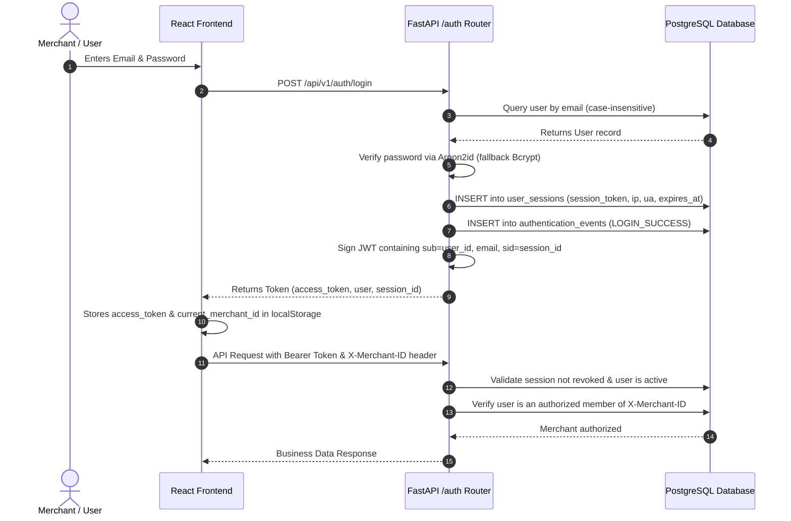
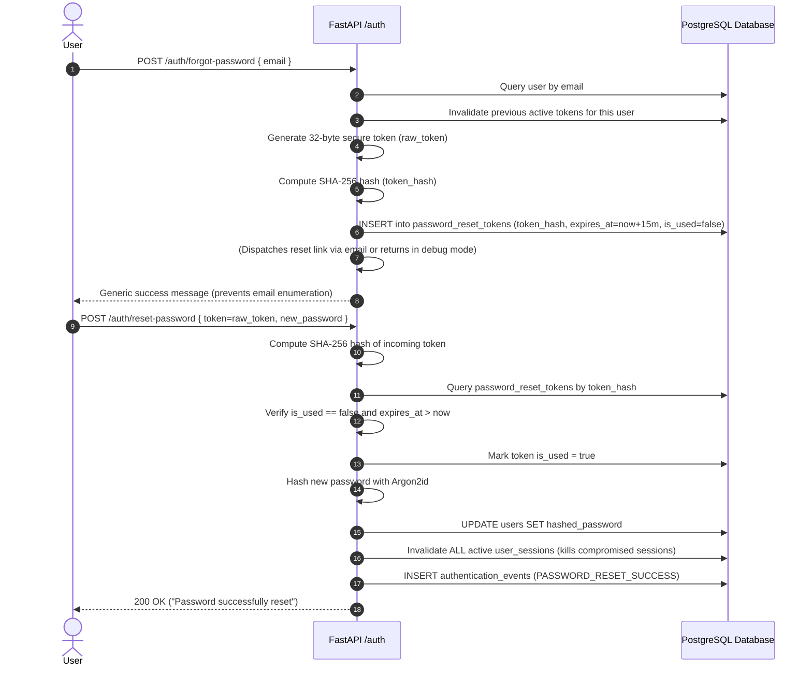

# Authentication, Identity, and Tenant Authorization

This document details the production-grade authentication, session management, and authorization architecture implemented in the PayPal Merchant Growth Engine.

---

## 1. Architectural Overview

The platform uses a hybrid **Stateful Session + Signed JWT** architecture paired with **Argon2id** password hashing and **Multi-Tenant Membership Resolution**.

---

## 2. Password Security & Hashing Standard

### A. Argon2id (Primary)
All new user registrations, password updates, and password resets are hashed using **Argon2id** (`argon2-cffi`), the winner of the Password Hashing Competition (PHC) and OWASP's top recommendation for password hashing:
- **Variant**: `argon2id` (hybrid of argon2i and argon2d, resistant to both side-channel and GPU/ASIC attacks)
- **Time Cost ($t$)**: 3 iterations
- **Memory Cost ($m$)**: 65,536 KiB (64 MB)
- **Parallelism ($p$)**: 4 threads
- **Salt Length**: 16 bytes cryptographically secure random bytes
- **Hash Length**: 32 bytes
- **Hash Prefix**: `$argon2id$v=19$m=65536,t=3,p=4$...`

### B. Verification & Backward Compatibility
The verification function in [`backend/app/core/security.py`](file:///c:/PayPal%20Merchant%20Growth%20Engine/backend/app/core/security.py) automatically identifies the hash algorithm:
1. If the hash starts with `$argon2`, verification uses `argon2.PasswordHasher().verify()`.
2. If the hash starts with `$2a$` or `$2b$`, verification falls back to `bcrypt.checkpw()`.
3. Legacy hashes can be transparently upgraded to Argon2id upon next successful login.

---

## 3. Stateful User Sessions & Revocation

While JWTs provide fast cryptographic signature verification, stateless tokens cannot be revoked on logout or credential compromise. To solve this, each login or registration generates a database-tracked session record:

### Database Entity: `user_sessions`
| Column | Type | Constraints / Description |
|---|---|---|
| `id` | VARCHAR(36) | Primary Key (UUID v4) |
| `user_id` | VARCHAR(36) | Foreign Key -> `users.id` (ON DELETE CASCADE) |
| `session_token` | VARCHAR(255) | Unique, cryptographically strong random token |
| `ip_address` | VARCHAR(45) | Client IP from request or `X-Forwarded-For` |
| `user_agent` | VARCHAR(255) | Client User-Agent header |
| `expires_at` | TIMESTAMPTZ | Absolute expiration (default: 24 hours) |
| `is_revoked` | BOOLEAN | Default `false`. Set to `true` on logout or password change |
| `created_at` | TIMESTAMPTZ | UTC timestamp |

### Session Enforcement
When validating the JWT in `get_current_user`, the backend checks the embedded session claim (`"sid"`):
- If `session.is_revoked == True` -> HTTP 401 Unauthorized (`"Session has been revoked or logged out."`).
- If `session.expires_at < now()` -> HTTP 401 Unauthorized (`"Session has expired. Please log in again."`).
- Calling `POST /api/v1/auth/logout` immediately marks `is_revoked = True`, instantly invalidating the JWT without waiting for expiration.

---

## 4. Single-Use Password Reset Lifecycle

Password resets must never store plain tokens in the database or transmit credentials insecurely:

### Key Security Safeguards
1. **At-Rest Token Hashing**: Only the deterministic SHA-256 hash of the random token is stored in the database. A database dump does NOT expose usable reset tokens.
2. **Short-Lived Expiration**: Tokens expire strictly 15 minutes after generation.
3. **Single-Use Enforcement**: Tokens are flagged `is_used = True` upon redemption; any subsequent attempt with the same token is rejected.
4. **Session Killing**: Resetting a password automatically revokes all active sessions across all devices.

---

## 5. Email Verification & Account Deactivation

### Email Verification
- Triggered via `POST /api/v1/auth/verify-email/request`.
- Generates a 32-byte token hashed with SHA-256 into `email_verification_tokens` (valid for 24 hours).
- Verified via `POST /api/v1/auth/verify-email/confirm`.
- Sets `users.is_verified = True`.

### Account Deactivation
- Triggered via `POST /api/v1/auth/deactivate`.
- Requires current password verification and explicit confirmation payload `{"confirmation": "DEACTIVATE"}`.
- Sets `users.is_active = False`.
- Revokes all active user sessions immediately.
- Blocks future logins with HTTP 403 Forbidden.

---

## 6. Authentication Events Audit Logging

Every security-sensitive event is persisted in the `authentication_events` table for compliance and anomaly detection:

| Field | Description |
|---|---|
| `id` | UUID primary key |
| `user_id` | Associated user UUID (or NULL if non-existent email) |
| `email_attempted` | Normalized email provided in request |
| `event_type` | Audit event tag (see below) |
| `ip_address` | Remote client IP (or parsed from `X-Forwarded-For`) |
| `user_agent` | Browser or client user-agent header |
| `created_at` | UTC timestamp |

### Supported Audit Events
- `REGISTER_SUCCESS`: User account created.
- `REGISTER_FAILURE_DUPLICATE`: Attempt to register an existing email.
- `LOGIN_SUCCESS`: Successful credential validation.
- `LOGIN_FAILURE_NOT_FOUND`: Non-existent email attempted.
- `LOGIN_FAILURE_WRONG_PASSWORD`: Bad password attempted.
- `LOGIN_FAILURE_INACTIVE`: Attempted login to deactivated account.
- `LOGOUT`: Explicit user logout.
- `PASSWORD_CHANGE_SUCCESS`: Authenticated user updated password.
- `PASSWORD_RESET_REQUESTED`: Password reset token generated.
- `PASSWORD_RESET_SUCCESS`: Password reset redeemed successfully.
- `PASSWORD_RESET_FAILED`: Invalid, expired, or reused reset token.
- `GOOGLE_LOGIN_SUCCESS`: Successful Google OpenID Connect verification.
- `GOOGLE_LOGIN_FAILURE`: Invalid or unverified Google token.
- `ACCOUNT_DEACTIVATED`: Account closed by user.
- `EMAIL_VERIFIED`: Email confirmed via verification token.

---

## 7. Multi-Tenant Authorization & Isolation

All business data endpoints enforce multi-tenant isolation via the `get_current_merchant` FastAPI dependency:

1. **Authentication First**: User must provide a valid JWT with an active session.
2. **Context Resolution**:
   - The frontend passes the target merchant ID in the `X-Merchant-ID` HTTP header.
   - The dependency verifies that an active `MerchantMember` record exists linking the authenticated user's `user.id` to the requested `merchant_id`.
   - If no `X-Merchant-ID` is passed, it defaults to the user's first registered merchant.
3. **Cross-Tenant Prevention**:
   - If a user requests a merchant ID they do not belong to, the backend returns HTTP 403 Forbidden: `"You do not have permission to access this merchant's data."`.
   - SQL queries are strictly scoped: `db.query(Product).filter(Product.merchant_id == merchant.id)`. Tenant isolation is never left to frontend filtering.
