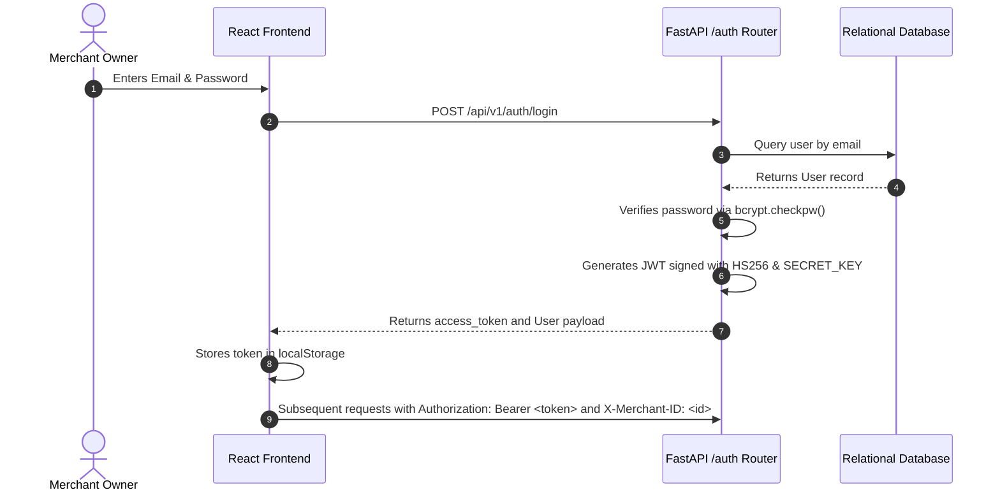

# Authentication, Security & Tenant Isolation

## 1. Authentication Architecture

The PayPal Merchant Growth Engine implements standard stateless JWT (JSON Web Token) authentication paired with Bcrypt password hashing.



---

## 2. Password Security
- **Algorithm**: `bcrypt` with dynamic salt generation (`gensalt()`).
- **Policy**: Minimum 8 characters required. Passwords are never stored in plaintext or logged.
- **Verification**: Evaluated using constant-time string comparison to prevent timing attacks.

---

## 3. JWT Token Lifecycle
- **Algorithm**: `HS256` (HMAC with SHA-256).
- **Default Expiration**: 1,440 minutes (24 hours). Configurable via `ACCESS_TOKEN_EXPIRE_MINUTES`.
- **Payload Claims**:
  ```json
  {
    "sub": "user_id_uuid",
    "email": "owner@apexfintech.io",
    "iat": 1793458800,
    "exp": 1793545200
  }
  ```

---

## 4. Multi-Tenant Dependency Resolution

Tenancy resolution is handled by FastAPI dependencies in `backend/app/core/dependencies.py`:

1. `get_current_user`: Decodes JWT token from `Authorization: Bearer <token>`. Validates token signature, expiration, and checks that `user.is_active == True`.
2. `get_current_merchant`: Resolves the active merchant context:
   - Reads `X-Merchant-ID` header if provided.
   - Verifies that the authenticated user holds an active membership (`MerchantMember`) for that merchant.
   - If no header is provided, automatically falls back to the user's primary/first registered merchant.
   - Rejects unauthorized cross-tenant requests with HTTP 403 Forbidden.
