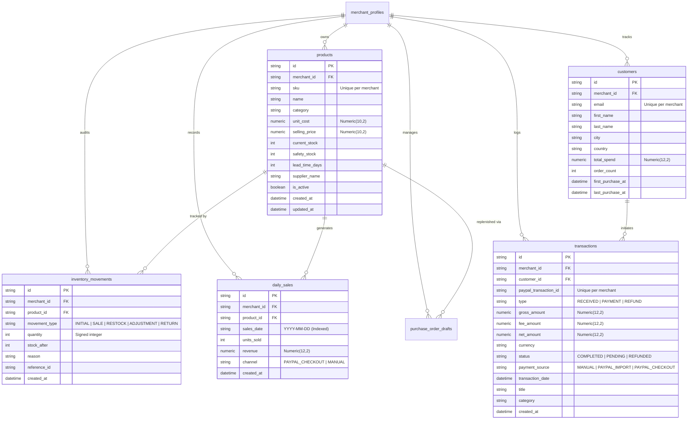

# Business Data Persistence: Products, Inventory Ledger, Daily Sales & Transactions

This document details the production-grade persistence lifecycle for core business entities implemented in the PayPal Merchant Growth Engine.

---

## 1. Architectural Overview & Domain ERD

The business data architecture guarantees strict multi-tenant isolation, immutable inventory audit trails, exact financial arithmetic via PostgreSQL `NUMERIC` types, and idempotent transaction ingestion.



---

## 2. Product Management

### A. Scoped SKU Uniqueness
The product catalog enforces that SKUs are unique strictly within each merchant's workspace:
```sql
CONSTRAINT uq_merchant_product_sku UNIQUE (merchant_id, sku)
```
- A single merchant cannot create duplicate SKUs (fails with `HTTP 400 Bad Request`).
- Distinct merchants can independently use standard industry SKUs (e.g. `IPHONE-15-BLK`) without namespace collision.

### B. Clean Persistence Lifecycle
- **Creation (`POST /api/v1/products`)**:
  - Persists immediately into PostgreSQL with exact `Numeric(10, 2)` monetary values.
  - Automatically records an `INITIAL` entry in `inventory_movements` recording initial stock on hand.
  - Generates an immutable `AuditLog` entry (`PRODUCT_CREATED`).
- **Updates (`PUT /api/v1/products/{id}`)**:
  - Updates only the specified product within the active merchant's scope.
  - Disallows modifying other merchants' products (returns `HTTP 404 Not Found`).
- **Archival Deletion (`DELETE /api/v1/products/{id}`)**:
  - Sets `is_active = False` rather than destructively deleting relational records to preserve historical sales and forecasting continuity.

---

## 3. Inventory Ledger & Stock Adjustments

Directly overwriting inventory numbers without an audit trail introduces shrinkage discrepancies. All stock changes are recorded in the `inventory_movements` ledger:

### A. Stock Movement Types
1. `INITIAL`: Inception stock upon product creation.
2. `SALE`: Stock depletion triggered by customer purchases or manual sales entries (negative quantity).
3. `RESTOCK`: Inventory replenishment from received purchase orders (positive quantity).
4. `ADJUSTMENT`: Merchant-initiated manual adjustments for physical cycle counts or damaged inventory write-offs.
5. `RETURN`: Restocked items from customer refunds or order cancellations.

### B. Prevention of Negative Stock
The `POST /api/v1/inventory/adjust-stock` endpoint strictly enforces non-negative stock invariants:
```python
resulting_stock = product.current_stock + adj.adjustment_units
if resulting_stock < 0:
    raise HTTPException(
        status_code=status.HTTP_400_BAD_REQUEST,
        detail=f"Adjustment would result in negative stock ({resulting_stock})."
    )
```

### C. Movement History Audit Endpoint
`GET /api/v1/inventory/movements`:
- Returns full chronological ledger with product SKU, movement type, signed quantity change, resulting stock level, reason, and reference ID.

---

## 4. Daily Sales History for Demand Forecasting

Forecasting algorithms (such as Holt-Winters Exponential Smoothing) require consistent daily observations.

### A. Persistence Structure
- Stored in `daily_sales` table with a composite uniqueness constraint:
  ```sql
  CONSTRAINT uq_merchant_product_daily_sale UNIQUE (merchant_id, product_id, sales_date)
  ```
- Date formatted as ISO-8601 string `YYYY-MM-DD` with B-Tree index for rapid temporal range queries.

### B. Accumulation Logic
When recording a sale via `POST /api/v1/sales/daily`:
- If an entry for that `(merchant_id, product_id, sales_date)` already exists, the backend safely increments `units_sold += new_units` and `revenue += new_revenue`.
- If no entry exists, a new record is created.
- In both cases, the product's `current_stock` is depleted and an `InventoryMovement(movement_type="SALE")` record is appended within the same atomic database transaction.

---

## 5. Sales & Transactions

The application supports dual modes of transaction ingestion with explicit provenance identification:

| Payment Source | Route | Behavior |
|---|---|---|
| `MANUAL` | `POST /api/v1/transactions` | Invoiced or manual revenue/expense recorded directly by merchant. |
| `PAYPAL_IMPORT` | `POST /api/v1/transactions/import-paypal` | Transaction history imported via CSV or sync. |
| `PAYPAL_CHECKOUT` | `POST /api/v1/paypal/checkout/capture` | Real-time verified PayPal webhook or order capture. |

### Idempotency Enforcement for PayPal Ingestion
To prevent duplicate double-counting during batch imports or network retries, `POST /api/v1/transactions/import-paypal` queries by `(merchant_id, paypal_transaction_id)`:
```python
existing = db.query(Transaction).filter(
    Transaction.merchant_id == current_merchant.id,
    Transaction.paypal_transaction_id == tx_in.paypal_transaction_id
).first()
if existing:
    return build_transaction_response(existing)  # Idempotent return without duplicate insertion
```

### Automated Customer Portfolio Tracking
When a transaction includes a customer email:
- The system checks if `Customer` exists for this merchant.
- If existing, increments `order_count`, adds to `total_spend`, and updates `last_purchase_at`.
- If new, creates a customer profile.
- This continuously populates the RFM customer clustering dataset in real time without batch ETL requirements.
