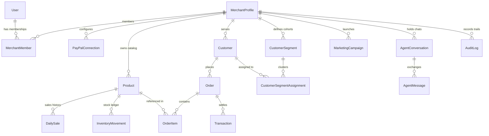

# Relational Database Schema & Data Architecture

## 1. Entity-Relationship Overview

The platform uses a relational database model implemented via **SQLAlchemy 2.0** supporting PostgreSQL and SQLite.

---

## 2. Table Specifications

### 2.1 Identity & Tenant Management
- `users`: Stores user identity, bcrypt password hash (`hashed_password`), active status, timestamps.
- `merchant_profiles`: The root multi-tenant entity containing `business_name`, `currency` (USD/EUR/GBP), `category`, `address`, and `phone`.
- `merchant_members`: Resolves Many-to-Many relationships between `users` and `merchant_profiles` with `role` (OWNER, ADMIN, ANALYST).

### 2.2 Product Catalog & Inventory
- `products`: Product master records: `sku`, `name`, `category`, `unit_cost`, `selling_price`, `current_stock`, `reorder_point`, `safety_stock`, `lead_time_days`, `supplier_name`, and `is_active`.
- `inventory_movements`: Immutable ledger tracking every stock mutation with `quantity`, `stock_after`, and `reason` (SALE, RESTOCK, ADJUSTMENT).
- `daily_sales`: Daily aggregated units sold and revenue per product used for time-series forecasting.
- `purchase_order_drafts`: Formal replenishment purchase orders with supplier information, unit costs, and status (`DRAFT`, `CONFIRMED`, `RECEIVED`).

### 2.3 Customers & Transactions
- `customers`: Persistent buyer profiles with `email`, `first_name`, `last_name`, `city`, `total_spend`, `order_count`, `first_purchase_at`, and `last_purchase_at`.
- `orders`: High-level buyer purchases with `paypal_order_id`, `gross_amount`, `fee_amount`, and `net_amount`.
- `order_items`: Line-item breakdown attaching specific products and quantities to orders.
- `transactions`: Immutable financial transaction record capturing PayPal transaction ID, gross, fee, net, type (`RECEIVED`, `PAYMENT`, `REFUND`), and status.

### 2.4 Analytics, Marketing & Agent State
- `customer_segments`: Cohorts computed by K-Means (`name`, `description`, `percentage`, `avg_spend`, `avg_recency_days`, `color`).
- `customer_segment_assignments`: Maps individual customers to their current RFM segment with calculated $R, F, M$ scores.
- `demand_forecasts`: Cached time-series forecasts with method, confidence intervals, and projected units.
- `marketing_campaigns`: Promotional campaigns grounded in RFM segments with promo codes and discount rates.
- `agent_conversations`, `agent_messages`, `agent_tool_executions`: Full persistent conversation history and tool invocation logs.
- `audit_logs`: Immutable system ledger tracking all administrative actions, data exports, and payment captures.

---

## 3. Indexing Strategy & Performance
- Index on `(merchant_id)` across all operational tables ensures $O(\log N)$ query times under high multi-tenant concurrency.
- Composite index on `(merchant_id, sku)` guarantees SKU uniqueness per merchant while allowing distinct merchants to reuse common SKU codes.
- Index on `(merchant_id, sales_date)` optimizes time-series window scans for Holt-Winters forecasting.
