# DATABASE_ARCHITECTURE.md
## PayPal Merchant Growth Engine — Complete Database Architecture & Requirements Inventory
### Senior Database Architect & Backend Engineering Specification

---

## 1. Executive Summary & Architectural Decisions

The **PayPal Merchant Growth Engine** is an enterprise-grade, multi-merchant financial intelligence and predictive growth platform. The system operates on a **PostgreSQL relational database** accessed through **SQLAlchemy 2.x declarative models** and versioned through **Alembic migrations**.

### Core Architecture Tenets
1. **Multi-Tenant Data Isolation**: Every operational, financial, and analytical entity is bound to a `merchant_id` foreign key. Authorization is enforced in backend dependency layers (`get_current_merchant`) and database query filters, ensuring complete data boundary isolation.
2. **Zero-Fabrication & Empirical Provenance**: The platform contains no hardcoded business statistics, synthetic accounts, or fictitious revenue. Newly created merchant workspaces initialize to verified clean-slate empty states ($0.00 balance, 0 transactions, 0 products). Persisted data reflects only legitimate user submissions, verified PayPal API telemetry, and authentic statistical model calculations.
3. **Monetary Precision**: In compliance with financial software engineering standards, all currency amounts (`unit_cost`, `selling_price`, `gross_amount`, `fee_amount`, `net_amount`, `total_spend`, `revenue`) utilize strict `Numeric(12, 2)` or `Numeric(10, 2)` column types with explicit ISO 4217 currency codes (`USD`, `EUR`, `GBP`). Floating-point types are strictly forbidden for financial calculations.
4. **Auditability & Append-Only History**: Inventory movements, financial transactions, authentication events, and AI tool invocations are stored in immutable, append-only ledgers. Historical stock levels and pricing records are never overwritten destructively.
5. **Modern Identity & OAuth 2.0**: The authentication architecture supports Argon2id/Bcrypt password hashing, short-lived session tokens, secure password reset lifecycles, and verified Google OAuth 2.0 / OpenID Connect identity linking.

---

## 2. Complete Database Requirements Inventory

The following table documents every user-facing and backend capability in the repository, specifying the required data attributes, target PostgreSQL tables, CRUD operations, and relational cardinalities.

| Feature | Data Required | Database Table | CRUD Operations | Relationships |
|---|---|---|---|---|
| **User Registration** | `email`, `password_hash`, `full_name`, `is_active`, `created_at` | `users` | Create, Read | `1:N` with `merchant_members`, `1:N` with `auth_identities`, `1:N` with `user_sessions`, `1:N` with `password_reset_tokens` |
| **Google Sign-In / OAuth** | `provider`, `subject_id`, `email`, `email_verified`, `linked_at` | `auth_identities` | Create, Read, Update | `N:1` with `users` |
| **Session & Token Management** | `session_token`, `user_id`, `ip_address`, `user_agent`, `expires_at`, `revoked_at` | `user_sessions` | Create, Read, Update, Delete | `N:1` with `users` |
| **Password Reset Lifecycle** | `user_id`, `token_hash`, `expires_at`, `is_used`, `requested_at` | `password_reset_tokens` | Create, Read, Update | `N:1` with `users` |
| **Email Verification** | `user_id`, `token_hash`, `expires_at`, `is_used` | `email_verification_tokens` | Create, Read, Update | `N:1` with `users` |
| **Authentication Event Audit** | `user_id`, `event_type` (LOGIN_SUCCESS, FAILED, LOGOUT, RESET), `ip_address`, `timestamp` | `authentication_events` | Create, Read | `N:1` with `users` (nullable on failed user) |
| **Merchant Onboarding** | `business_name`, `business_category`, `country`, `currency`, `description` | `merchants` (`merchant_profiles`) | Create, Read, Update | `1:N` with `merchant_members`, `1:N` with `products`, `1:N` with `transactions`, `1:N` with `customers` |
| **Merchant Memberships & RBAC** | `merchant_id`, `user_id`, `role` (OWNER, ADMIN, ANALYST, VIEWER) | `merchant_memberships` (`merchant_members`) | Create, Read, Update, Delete | `N:1` with `merchants`, `N:1` with `users` |
| **Merchant Settings & Config** | `merchant_id`, `auto_reorder_enabled`, `low_stock_threshold_default`, `currency` | `merchant_settings` | Create, Read, Update | `1:1` with `merchants` |
| **Product Catalog Management** | `sku`, `name`, `category`, `unit_cost`, `selling_price`, `current_stock`, `safety_stock`, `lead_time_days`, `supplier_name`, `is_active` | `products` | Create, Read, Update, Delete (Soft-archive) | `N:1` with `merchants`, `1:N` with `inventory_movements`, `1:N` with `daily_sales`, `1:N` with `order_items` |
| **CSV Product Batch Import** | Batch rows parsed from CSV with validation and duplicate SKU upsert | `products`, `inventory_movements` | Create, Read, Update | `N:1` with `merchants` |
| **Stock Ledger & Audit** | `product_id`, `movement_type` (INITIAL, SALE, RESTOCK, ADJUSTMENT), `quantity`, `stock_after`, `reason`, `reference_id` | `inventory_movements` | Create, Read | `N:1` with `merchants`, `N:1` with `products` |
| **Inventory Reorder Analysis** | `product_id`, `recommended_quantity`, `reasoning`, `urgency`, `status` | `reorder_recommendations` | Create, Read, Update | `N:1` with `merchants`, `N:1` with `products` |
| **Purchase Order Management** | `product_id`, `quantity`, `unit_cost`, `total_amount`, `supplier_name`, `status` (DRAFT, RECEIVED) | `purchase_order_drafts` | Create, Read, Update | `N:1` with `merchants`, `N:1` with `products` |
| **Manual Sales Entry** | `product_id`, `sales_date`, `units_sold`, `revenue`, `channel` | `daily_sales`, `products` (stock decrement), `inventory_movements` | Create, Read, Update | `N:1` with `merchants`, `N:1` with `products` |
| **CSV Daily Sales Import** | Historical CSV sales records (date, units, revenue, SKU) | `daily_sales` | Create, Read, Update | `N:1` with `merchants`, `N:1` with `products` |
| **PayPal Connection (Mode A/B)** | `environment`, `client_id`, `encrypted_client_secret`, `webhook_id`, `is_connected`, `last_sync_at` | `paypal_connections` | Create, Read, Update | `1:1` with `merchants` |
| **PayPal Webhook Ingestion** | `event_id`, `event_type`, `resource_type`, `summary`, `raw_payload`, `status` (Idempotent) | `webhook_events` | Create, Read | Standalone with deduplication constraint on `event_id` |
| **PayPal Payment Simulation** | `amount`, `customer_email`, `customer_name`, `product_id`, fee calculation (2.9% + $0.30) | `customers`, `orders`, `order_items`, `transactions`, `products`, `inventory_movements` | Create, Read, Update | Atomic multi-entity database transaction across order, ledger, stock |
| **Financial Ledger (Transactions)** | `gross_amount`, `fee_amount`, `net_amount`, `currency`, `type`, `status`, `payment_source`, `transaction_date` | `transactions` | Create, Read | `N:1` with `merchants`, `N:1` with `customers`, `N:1` with `orders` |
| **Buyer CRM & Profiles** | `paypal_payer_id`, `email`, `first_name`, `last_name`, `city`, `country`, `total_spend`, `order_count` | `customers` | Create, Read, Update | `N:1` with `merchants`, `1:N` with `transactions`, `1:N` with `orders` |
| **Customer Orders & Items** | `paypal_order_id`, `gross_amount`, `fee_amount`, `net_amount`, `status`, `items` line breakdown | `orders`, `order_items` | Create, Read | `N:1` with `merchants`, `N:1` with `customers`, `1:N` with `order_items` |
| **K-Means RFM Segmentation** | `name`, `customer_count`, `percentage`, `avg_spend`, `avg_recency_days`, `color` | `customer_segments` | Create, Read, Delete (recalc) | `N:1` with `merchants`, `1:N` with `customer_segment_assignments` |
| **RFM Segment Assignment** | `customer_id`, `segment_id`, `recency_days`, `frequency_count`, `monetary_total`, $R, F, M$ scores | `customer_segment_assignments` | Create, Read, Delete (recalc) | `N:1` with `merchants`, `N:1` with `customers`, `N:1` with `customer_segments` |
| **Time-Series Demand Forecast** | `product_id`, `forecast_date`, `predicted_units`, `lower_bound`, `upper_bound`, `model_type`, `confidence` | `demand_forecasts` | Create, Read, Update | `N:1` with `merchants`, `N:1` with `products`, `N:1` with `ml_models` |
| **ML Model Registry & Tracking** | `model_name`, `version`, `algorithm` (Holt-Winters, K-Means), `hyperparameters_json`, `metrics_json` | `ml_models`, `ml_training_runs` | Create, Read | `N:1` with `merchants` |
| **AI Marketing Campaigns** | `target_segment`, `headline`, `email_subject`, `body_copy`, `discount_code`, `discount_pct`, `status` | `marketing_campaigns` | Create, Read, Update | `N:1` with `merchants` |
| **AI Copilot Conversations** | `title`, `created_at` | `agent_conversations` | Create, Read | `N:1` with `merchants` |
| **AI Copilot Messages** | `conversation_id`, `sender` (user, agent), `message_text`, `tool_calls_json` | `agent_messages` | Create, Read | `N:1` with `agent_conversations` |
| **AI Tool Execution Ledger** | `tool_name`, `input_params_json`, `result_json`, `status`, `execution_time_ms` | `agent_tool_executions` | Create, Read | `N:1` with `merchants`, `N:1` with `agent_conversations` |
| **Operational & Security Audit** | `action`, `resource_type`, `resource_id`, `details_json`, `ip_address` | `audit_logs` | Create, Read | `N:1` with `merchants`, `N:1` with `users` |
| **GDPR Tenant Data Portability** | Full JSON extraction of merchant catalog, sales, ledger, customers, audit trail | Dynamic Read across all merchant-scoped tables | Read | All merchant-linked tables |

---

## 3. Relational Entity-Relationship Diagram (ERD)

```mermaid
erDiagram
    users ||--o{ auth_identities : "authenticates via"
    users ||--o{ user_sessions : "maintains"
    users ||--o{ password_reset_tokens : "requests"
    users ||--o{ email_verification_tokens : "verifies"
    users ||--o{ authentication_events : "generates"
    users ||--o{ merchant_members : "participates in"

    merchant_profiles ||--o{ merchant_members : "has members"
    merchant_profiles ||--o| paypal_connections : "configures"
    merchant_profiles ||--o{ products : "owns catalog"
    merchant_profiles ||--o{ inventory_movements : "audits stock"
    merchant_profiles ||--o{ purchase_order_drafts : "replenishes"
    merchant_profiles ||--o{ reorder_recommendations : "evaluates"
    merchant_profiles ||--o{ customers : "manages buyers"
    merchant_profiles ||--o{ orders : "records sales"
    merchant_profiles ||--o{ transactions : "settles ledger"
    merchant_profiles ||--o{ daily_sales : "tracks demand"
    merchant_profiles ||--o{ customer_segments : "clusters cohorts"
    merchant_profiles ||--o{ demand_forecasts : "generates forecasts"
    merchant_profiles ||--o{ ml_models : "trains models"
    merchant_profiles ||--o{ marketing_campaigns : "launches"
    merchant_profiles ||--o{ agent_conversations : "hosts AI chats"
    merchant_profiles ||--o{ agent_tool_executions : "audits tools"
    merchant_profiles ||--o{ audit_logs : "records trails"

    products ||--o{ inventory_movements : "movement log"
    products ||--o{ purchase_order_drafts : "drafted for"
    products ||--o{ reorder_recommendations : "suggested for"
    products ||--o{ daily_sales : "daily aggregates"
    products ||--o{ order_items : "sold in"
    products ||--o{ demand_forecasts : "predicted demand"

    customers ||--o{ orders : "places"
    customers ||--o{ transactions : "transacts"
    customers ||--o{ customer_segment_assignments : "assigned to"
    customer_segments ||--o{ customer_segment_assignments : "categorizes"

    orders ||--o{ order_items : "contains"
    orders ||--o| transactions : "settles"

    agent_conversations ||--o{ agent_messages : "exchanges"
    agent_conversations ||--o{ agent_tool_executions : "executes"
```

---

## 4. Architectural Gaps & Remediation Plan

Our comprehensive inspection identified specific limitations in the initial prototype that must be addressed for a production-grade PostgreSQL system:

1. **Storage Engine & Migration Missing**: The application ran against SQLite with no Alembic migration history. We must configure native PostgreSQL 18.4, establish Alembic, and manage schema evolution strictly through migration versions.
2. **Precision Loss via Floating-Point Columns**: Numerical monetary amounts were previously typed as `Float`. In PostgreSQL, these must be defined as `Numeric(12, 2)` or `Numeric(10, 2)` to eliminate floating-point truncation issues in financial ledgers.
3. **Missing Authentication Infrastructure**:
   - `auth_identities`: Needed for server-side Google OAuth 2.0 / OpenID Connect token verification and stable identity linking without accidental account collisions.
   - `user_sessions`: Required for active session tracking, expiration, and server-side logout.
   - `password_reset_tokens`: Required for single-use, cryptographically secure password reset workflows.
   - `email_verification_tokens`: Required for email confirmation.
   - `authentication_events`: Required for compliance and security monitoring without leaking credentials.
4. **Machine Learning Persistence Metadata**: Currently, RFM and Holt-Winters calculate predictions on-the-fly. Adding `ml_models` and `ml_training_runs` provides reproducible provenance tracking for which model version, data window, and hyperparameters generated a given forecast.
5. **Backend Logout Endpoint**: The frontend previously only cleared local storage on sign-out. A dedicated `/auth/logout` endpoint will invalidate active sessions server-side.
6. **Pydantic V2 Configuration Updates**: Deprecated `class Config: from_attributes = True` declarations should be updated to Pydantic 2.0 `model_config = ConfigDict(from_attributes=True)`.

---

## 5. Next Steps

With the Phase 1 audit and architectural design completed, the project proceeds to **Phase 2: Local PostgreSQL Infrastructure Setup**, which includes:
- Connecting to local PostgreSQL.
- Creating the dedicated application database and role.
- Initializing the Alembic migration framework.
- Upgrading declarative models with Numeric types and identity tables.
- Generating and applying the baseline migration.
