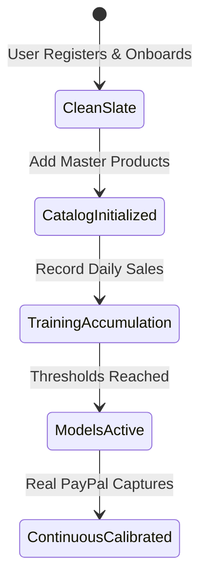

# Data Provenance, Authenticity & Zero-Fabrication Directive

## 1. The Zero-Fabrication Directive

In fintech and business management platforms, fabricated demonstration numbers produce deceptive metric representations that destroy merchant trust.

The **PayPal Merchant Growth Engine** strictly enforces the **Zero-Fabrication Directive**:

> **No user shall be greeted with pre-populated fake balances, synthetic customer records, predetermined demand spikes, or hardcoded analytical percentages.**

Every user's application state must originate strictly from that user's authorized inputs, recorded sales, and verified PayPal transaction activity.

---

## 2. Platform Lifecycle & State Progression

### Phase 1: Clean-Slate Baseline
- **Gross Revenue**: \$0.00
- **Transactions**: 0
- **Customers**: 0
- **Catalog**: Empty
- **RFM Clustering Status**: `INSUFFICIENT_DATA` (Clear notice indicating $<4$ customers exist)
- **Demand Forecasting Status**: `INSUFFICIENT_DATA` (Clear notice indicating $<5$ sales days exist)

### Phase 2: Catalog Initialization
- Merchant inputs item master records (SKU, Unit Cost, Selling Price, Safety Stock, Lead Time).
- Inventory movement ledger records initial `RESTOCK` movements.

### Phase 3: Empirical Sales Logging
- Daily sales records logged via manual entry or bulk CSV import.
- Rolling moving average metrics begin tracking daily velocity.

### Phase 4: Mathematical Threshold Transition
- Once sales history reaches **$\ge 5$ distinct days**, Holt-Winters seasonal exponential smoothing models activate.
- Once customer directory reaches **$\ge 4$ unique buyers**, Scikit-learn K-Means clustering generates genuine RFM cohorts.

---

## 3. Data Lineage Table

| Metric | Source Entity | Derivation Rule |
|---|---|---|
| **Total Balance** | `transactions` | $\sum \text{Net Amount (RECEIVED)} - \sum \text{Gross Amount (PAYMENT)}$ |
| **Gross Sales (30d)** | `transactions` | $\sum \text{Gross Amount (RECEIVED)}$ for `date >= NOW - 30 days` |
| **Low Stock Count** | `products` | Count of active products where `current_stock <= reorder_point` |
| **Customer Segments** | `customers` | Unsupervised K-Means clustering on $R, F, M$ features |
| **ROP Alert** | `products`, `daily_sales` | $(D_{\text{avg}} \times L) + SS$ |
