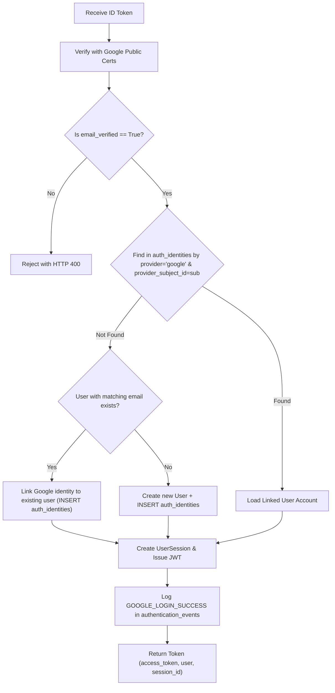

# Google OAuth 2.0 / OpenID Connect Setup Guide

This guide describes how to configure and operate legitimate Google Sign-In and OpenID Connect identity linking in the PayPal Merchant Growth Engine.

---

## 1. Overview

The application implements standard Google OpenID Connect token verification:
- The React frontend receives a signed JWT ID token from Google Identity Services.
- The ID token is passed to `POST /api/v1/auth/google`.
- The FastAPI backend validates the token server-side using Google's official public certificates via `google.oauth2.id_token.verify_oauth2_token`.
- Validated identities are safely linked to internal user accounts and recorded in `auth_identities`.

---

## 2. Google Cloud Console Configuration

To enable Google Sign-In, follow these steps to obtain genuine Google OAuth credentials:

### Step 1: Create or Select a GCP Project
1. Navigate to the [Google Cloud Console](https://console.cloud.google.com/).
2. Create a new project named `PayPal Merchant Growth Engine` (or select an existing project).

### Step 2: Configure the OAuth Consent Screen
1. Go to **APIs & Services** > **OAuth consent screen**.
2. Select **External** (or **Internal** if using Google Workspace).
3. Fill in the required fields:
   - **App Name**: `PayPal Merchant Growth Engine`
   - **User Support Email**: Your developer or admin email.
   - **Developer Contact Email**: Your email.
4. Under **Scopes**, ensure the standard OpenID Connect scopes are added:
   - `.../auth/userinfo.email`
   - `.../auth/userinfo.profile`
   - `openid`
5. If in "Testing" mode, add your test Google account under **Test users**.

### Step 3: Create OAuth 2.0 Client ID
1. Navigate to **APIs & Services** > **Credentials**.
2. Click **Create Credentials** > **OAuth client ID**.
3. Select **Application type**: `Web application`.
4. Enter **Name**: `PayPal Growth Engine Web Client`.
5. Under **Authorized JavaScript origins**, add:
   - `http://localhost:5173`
   - `http://127.0.0.1:5173`
   - `http://localhost:3000`
   - `http://127.0.0.1:3000`
6. Under **Authorized redirect URIs**, add:
   - `http://localhost:5173/auth/google/callback`
   - `http://127.0.0.1:5173/auth/google/callback`
7. Click **Create**.
8. Copy the generated **Client ID** (e.g., `123456789-abc.apps.googleusercontent.com`) and **Client Secret**.

---

## 3. Environment Variable Configuration

Add the credentials to both the root `.env` and `backend/.env` files:

```env
# Google OAuth 2.0 / OpenID Connect
GOOGLE_CLIENT_ID=your-actual-client-id.apps.googleusercontent.com
GOOGLE_CLIENT_SECRET=your-actual-client-secret
GOOGLE_REDIRECT_URI=http://localhost:5173/auth/google/callback
```

And in the frontend `.env`:
```env
VITE_GOOGLE_CLIENT_ID=your-actual-client-id.apps.googleusercontent.com
```

> [!IMPORTANT]
> If `GOOGLE_CLIENT_ID` is empty or not set in the backend environment, the API gracefully rejects Google login attempts with `HTTP 503 SERVICE_UNAVAILABLE`:
> `"Google OAuth is not configured on this server. Please configure GOOGLE_CLIENT_ID and GOOGLE_CLIENT_SECRET in backend/.env."`
> The backend **never fabricates** mock Google authentication responses.

---

## 4. Server-Side Verification Flow

The verification logic in [`backend/app/core/security.py`](file:///c:/PayPal%20Merchant%20Growth%20Engine/backend/app/core/security.py) executes the following verification steps:

```python
from google.oauth2 import id_token
from google.auth.transport import requests as google_requests

def verify_google_id_token(id_token_str: str) -> dict:
    request = google_requests.Request()
    id_info = id_token.verify_oauth2_token(
        id_token_str,
        request,
        settings.GOOGLE_CLIENT_ID
    )

    # Validate issuer according to OpenID Connect standards
    if id_info.get("iss") not in ["accounts.google.com", "https://accounts.google.com"]:
        raise ValueError("Invalid Google token issuer.")

    return id_info
```

### Security Checks Enforced:
1. **Cryptographic Signature Verification**: Validates RSA cryptographic signature against Google's published public keys (`https://www.googleapis.com/oauth2/v3/certs`).
2. **Audience Check (`aud`)**: Ensures `aud` matches `settings.GOOGLE_CLIENT_ID` to prevent tokens issued for other applications from being replayed here.
3. **Issuer Check (`iss`)**: Ensures `iss` is `accounts.google.com` or `https://accounts.google.com`.
4. **Token Expiration (`exp`)**: Automatically verified by `google-auth` to reject expired tokens.
5. **Verified Email Enforcement**: Checks `id_info["email_verified"] is True`. If Google reports an unverified email, the login request is rejected with `HTTP 400 BAD_REQUEST`.

---

## 5. Account Linking & Identity Persistence

When a validated ID token is received by `POST /api/v1/auth/google`:



### Persistence Guarantees
1. **Stable Subject Identifier**: The user's stable Google account ID (`id_info["sub"]`) is stored in `auth_identities.provider_subject_id`.
2. **No Duplicates**: Subsequent logins using the same Google account resolve the existing user via the unique index on `(provider, provider_subject_id)`.
3. **Safe Identity Linking**: Existing email/password accounts can link their Google identity seamlessly, provided the Google email has been confirmed by Google.
