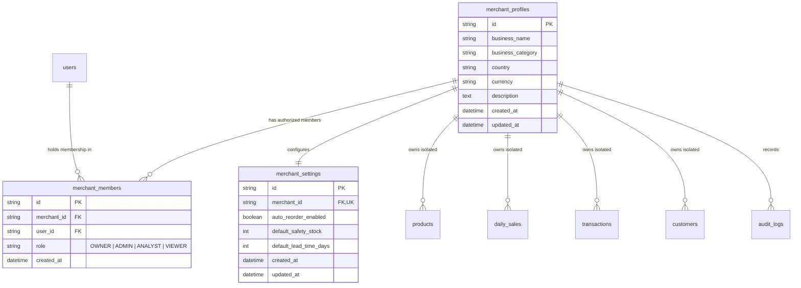
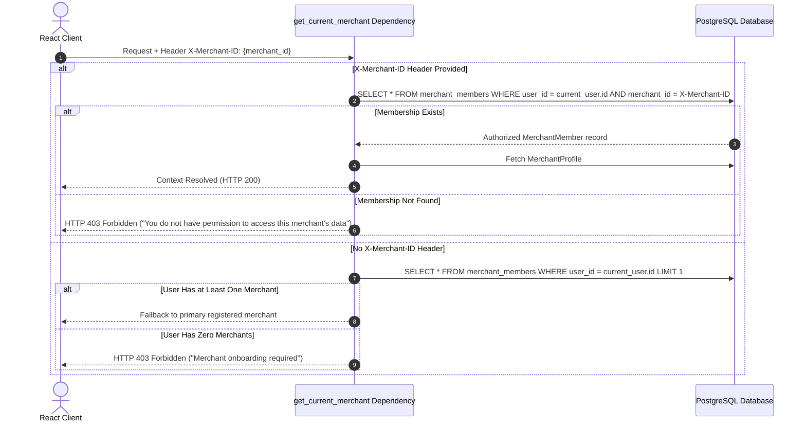

# Merchant Management & Multi-Tenant Isolation

This document outlines the multi-merchant tenant architecture, role-based access control (RBAC), team collaboration, and data isolation mechanisms implemented in the PayPal Merchant Growth Engine.

---

## 1. Multi-Tenant Architecture Overview

The system enforces strict **logical tenant isolation** at both the database layer and the backend application layer. A single user can belong to multiple merchants, and a merchant workspace can have multiple users with granular permissions.

---

## 2. Tenant Context Resolution (`X-Merchant-ID`)

Every request to a merchant-scoped endpoint resolves the active tenant through the `get_current_merchant` FastAPI dependency:

### Absolute Isolation Guarantees:
- **No Cross-Tenant Leaks**: A user cannot query, update, or delete another merchant's records simply by passing another merchant's UUID.
- **Backend Query Scoping**: Every business query explicitly filters by `merchant_id == current_merchant.id`. Frontend filtering is never relied upon for tenant security.

---

## 3. Clean-Slate Merchant Onboarding

Newly registered users onboard their businesses via `POST /api/v1/merchants/onboarding`:
- **Zero Mock Values**: The workspace is initialized completely empty. There are no permanently populated mock products, fake revenue numbers, or fabricated customer orders.
- **Automatic Role Assignment**: The onboarding creator is automatically registered as `OWNER` in `merchant_members`.
- **Default Operational Settings**: Automatically initializes a `merchant_settings` record with:
  - `auto_reorder_enabled`: `false`
  - `default_safety_stock`: `10`
  - `default_lead_time_days`: `7`
- **Audit Trail**: Generates an immutable `AuditLog` entry tagged `MERCHANT_CREATED`.

---

## 4. Role-Based Access Control (RBAC) Matrix

The system implements four distinct workspace roles:

| Capability | OWNER | ADMIN | ANALYST | VIEWER |
|---|:---:|:---:|:---:|:---:|
| View Dashboard & Analytics | :white_check_mark: | :white_check_mark: | :white_check_mark: | :white_check_mark: |
| View Products, Inventory & Transactions | :white_check_mark: | :white_check_mark: | :white_check_mark: | :white_check_mark: |
| Run ML Models (Forecasting, RFM Clustering) | :white_check_mark: | :white_check_mark: | :white_check_mark: | :x: |
| Record Manual Sales & Create Products | :white_check_mark: | :white_check_mark: | :white_check_mark: | :x: |
| Connect PayPal Sandbox / Live Credentials | :white_check_mark: | :white_check_mark: | :x: | :x: |
| Update Merchant Profile & Operating Settings | :white_check_mark: | :white_check_mark: | :x: | :x: |
| Invite Members (`ADMIN`, `ANALYST`, `VIEWER`) | :white_check_mark: | :white_check_mark: | :x: | :x: |
| Remove Members (`ADMIN`, `ANALYST`, `VIEWER`) | :white_check_mark: | :white_check_mark: | :x: | :x: |
| Promote / Demote Workspace Roles | :white_check_mark: | :x: | :x: | :x: |
| Remove Other Owners | :white_check_mark: | :x: | :x: | :x: |
| Delete Merchant Workspace | :white_check_mark: | :x: | :x: | :x: |

### RBAC Safeguards Enforced:
1. **Sole Owner Protection**: The system prevents demoting or removing the only `OWNER` of a merchant workspace (HTTP 400).
2. **Owner-Only Privilege**: Only an `OWNER` can remove or modify another `OWNER`'s membership.
3. **Role Checks in Dependencies**: `require_merchant_owner` and `require_merchant_admin` dependencies protect sensitive routes at the framework level.

---

## 5. Team Collaboration & Member Management Endpoints

| Endpoint | Method | Required Role | Description |
|---|---|---|---|
| `/api/v1/merchants/me/members` | `GET` | Any Member | Lists all team members, emails, roles, and join dates. |
| `/api/v1/merchants/me/members` | `POST` | ADMIN / OWNER | Invites an existing registered user by email with role. |
| `/api/v1/merchants/me/members/{id}` | `PUT` | OWNER | Updates a member's role (enforcing sole owner protection). |
| `/api/v1/merchants/me/members/{id}` | `DELETE` | ADMIN / OWNER | Removes a member from the workspace (invalidating access). |

---

## 6. Merchant Settings & Data Portability (GDPR)

### Operational Settings
- `GET /api/v1/merchants/me/settings`: Retrieves stock thresholds and replenishment lead times.
- `PUT /api/v1/merchants/me/settings`: Updates `auto_reorder_enabled`, `default_safety_stock`, and `default_lead_time_days`.

### GDPR Compliance & JSON Export
- `GET /api/v1/settings/export`: Generates a single, portable JSON export containing:
  - Merchant metadata and currency.
  - Active products, SKU lists, and inventory quantities.
  - Aggregated historical daily sales counts.
  - Transaction logs and customer profiles.
  - Full audit event logs.
