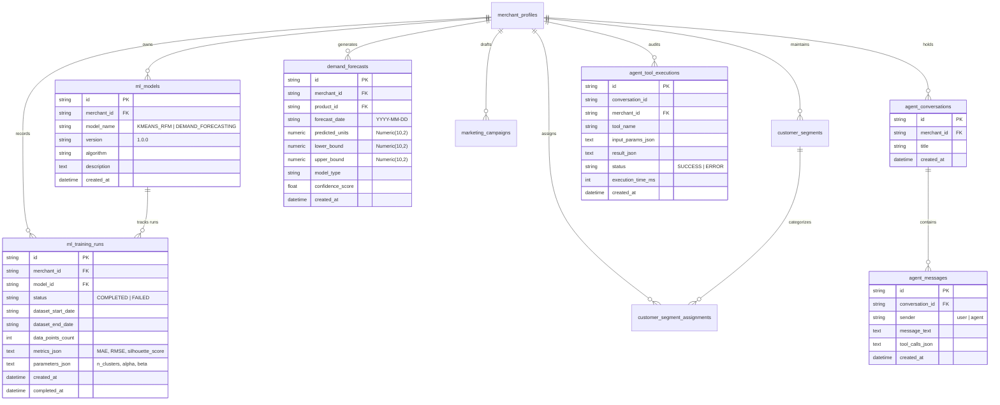

# Machine Learning and Agentic AI Persistence

This document details the persistence lifecycle for machine learning models, training run metrics, RFM customer segmentations, demand forecasts, marketing drafts, and AI assistant conversations in the PayPal Merchant Growth Engine.

---

## 1. Architectural Overview & Domain ERD

The system maintains a strict separation between **historical transactional ground truth** and **probabilistic ML/AI outputs**. Model metadata, training execution metrics, predictions, and multi-turn chat interactions are fully persisted in PostgreSQL:

---

## 2. Machine Learning Data Sufficiency & Grounding

The engine refuses to hallucinate statistical predictions when historical data is insufficient:

### A. RFM Customer Clustering
- **Minimum Data Gate**: Requires at least **4 distinct customers** with historical transactions.
- **Insufficient State**: When $< 4$ customers exist, returns `status="INSUFFICIENT_DATA"` with actionable instructions to record sales or connect PayPal.
- **Sufficient State**:
  - Executes Scikit-learn $K$-Means clustering ($k \le 4$) with log-transformed Recency, Frequency, and Monetary features after standard scaling (`StandardScaler`).
  - Calculates cluster silhouette scores (`sklearn.metrics.silhouette_score`).
  - Clears previous assignments and persists fresh `customer_segments` and `customer_segment_assignments` linked to each customer UUID.
  - Registers model in `ml_models` and appends an execution log in `ml_training_runs` with `metrics_json` (silhouette score, customer count).

### B. Daily Demand Forecasting
- **Minimum Data Gate**: Requires at least **5 recorded daily sales entries** for the target product.
- **Insufficient State**: Returns `data_sufficiency_status="INSUFFICIENT_DATA"`.
- **Sufficient State**:
  - If $\ge 14$ daily observations exist, fits a Holt-Winters Exponential Smoothing model with additive trend and damping.
  - If between 5 and 13 daily observations exist, computes a 5-day weighted moving average (WMA).
  - Computes 95% confidence intervals ($\pm 1.96 \cdot \sigma$) for upper and lower prediction bounds.
  - Persists each projected day into `demand_forecasts` with composite unique constraint `(merchant_id, product_id, forecast_date)`.
  - Records the training run in `ml_training_runs` capturing historical daily average, standard deviation, and sample count.

---

## 3. Marketing Insights Persistence

Merchants can convert RFM segment findings into targeted promotional campaigns via `POST /api/v1/marketing/campaigns`:
- Calculates real audience reach dynamically from the database (`SELECT COUNT(*) FROM customers WHERE merchant_id = ...`).
- Persists headline, subject line, body copy, discount code, and discount percentage into `marketing_campaigns` with `status="DRAFT"`.
- Supports explicit activation via `PUT /api/v1/marketing/campaigns/{id}/activate`, transitioning the record to `"ACTIVE"`.

---

## 4. Agentic AI Conversation & Tool Execution Ledger

Every interaction with the AI assistant is fully audited and persisted:

### A. Multi-Turn Conversations
- `POST /api/v1/agent/chat`:
  - If no `conversation_id` is supplied, generates a new `agent_conversations` record.
  - Stores incoming user prompt as `AgentMessage(sender="user")`.
  - Executes deterministic backend tools strictly scoped to `merchant_id`.
  - Stores generated response as `AgentMessage(sender="agent")` with embedded `tool_calls_json`.
- `GET /api/v1/agent/conversations`: Lists recent strategy sessions for the merchant.
- `GET /api/v1/agent/conversations/{id}`: Returns the full chronological transcript of messages.

### B. Tool Execution Audit Trail
- Each backend tool invoked by the assistant (`get_inventory_status`, `calculate_reorder_recommendation`, `get_customer_segments`, `get_merchant_overview`, `generate_campaign_draft`) records an `agent_tool_executions` entry:
  - `tool_name`
  - `input_params_json` (sanitized parameters, never credentials)
  - `result_json`
  - `execution_time_ms`
  - `status` (`SUCCESS` or `ERROR`)
- `GET /api/v1/agent/tool-executions`: Allows merchants to inspect the internal tools executed by the AI assistant.
