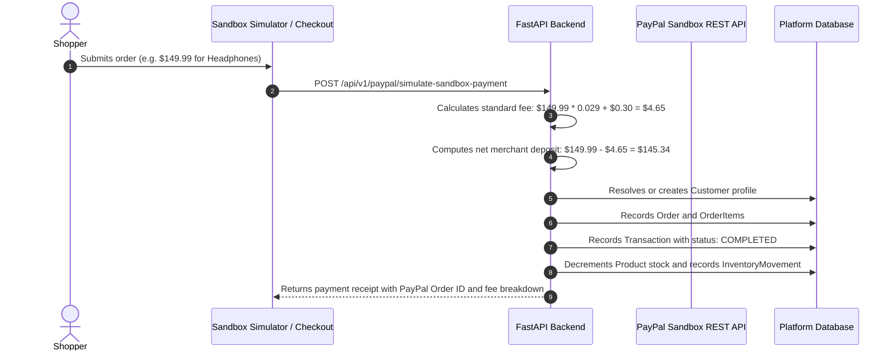

# PayPal Developer Platform Integration Guide

## 1. Integration Overview

The platform connects to the PayPal Developer Platform through two distinct operational modes:

### Mode A: Hackathon Team Sandbox (Default Fallback)
Configured at the platform level via server environment variables (`PAYPAL_CLIENT_ID`, `PAYPAL_CLIENT_SECRET`, `PAYPAL_ENVIRONMENT`). Allows evaluators to test live captures without entering personal credentials.

### Mode B: Merchant Dedicated Connect (Self-Serve BYOK)
Merchants input their own Sandbox or Production REST API credentials on the **PayPal Integration** page. Secrets are encrypted symmetrically at rest in the `paypal_connections` table using the application `SECRET_KEY`.

---

## 2. Orders API v2 & Payment Capture

---

## 3. PayPal Fee Calculation Engine

In accordance with PayPal US Commercial Transaction rates, all processed transactions compute the standard merchant fee schedule:

$$\text{Fee} = (\text{Gross Amount} \times 0.029) + \$0.30$$
$$\text{Net Amount} = \text{Gross Amount} - \text{Fee}$$

*Example: A \$100.00 customer purchase results in a \$3.20 fee deduction and a \$96.80 net deposit to the merchant's real-time balance.*

---

## 4. Webhook Ingestion & Idempotency

Webhooks received at `/api/v1/paypal/webhooks` are handled with strict idempotency:
1. Every incoming event is checked against the `webhook_events` table by `(merchant_id, event_id)`.
2. Duplicate event IDs return HTTP 200 immediately without redundant database mutations.
3. Supported PayPal event types:
   - `CHECKOUT.ORDER.APPROVED`
   - `PAYMENT.CAPTURE.COMPLETED`
   - `PAYMENT.CAPTURE.REFUNDED`
   - `CUSTOMER.DISPUTE.CREATED`
