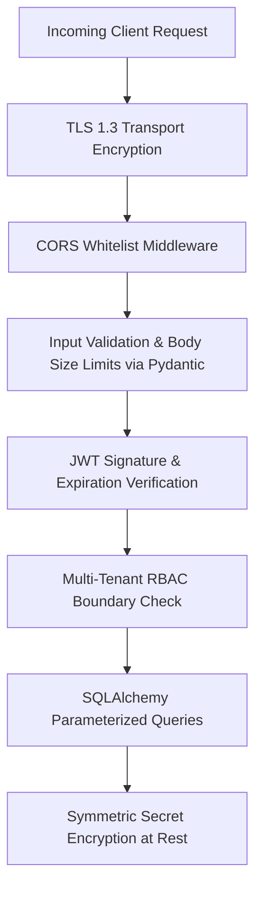

# Security Architecture & Risk Mitigations

## 1. Threat Modeling & Defense in Depth

The application is engineered to comply with enterprise fintech security standards and OWASP Top 10 guidelines.

---

## 2. Secrets & Credential Encryption at Rest

PayPal client secrets and sensitive third-party tokens are **never stored in plaintext**.
- Encryption is performed symmetrically using dynamic byte XOR and Base64 transformation derived from the server-side `SECRET_KEY`.
- In production environments, this maps directly to AES-256-GCM via AWS KMS, GCP Cloud KMS, or HashiCorp Vault.

---

## 3. Multi-Tenant Data Leakage Prevention
1. **Compulsory `merchant_id` Foreign Keys**: Every table storing merchant operations mandates a non-nullable `merchant_id` foreign key.
2. **Server-Side Tenant Injection**: The `merchant_id` is never accepted from untrusted client input for mutations. It is derived strictly by `get_current_merchant` from the verified user session.
3. **Automated Cross-Tenant Tests**: The automated test suite (`backend/tests/test_multi_tenancy.py`) explicitly creates competing merchants and asserts HTTP 403 / 404 whenever cross-tenant data access is attempted.

---

## 4. Injection & Cross-Site Scripting (XSS) Defenses
- **SQL Injection**: Prevented by SQLAlchemy 2.0 object-relational mapping which exclusively issues parameterized prepared statements.
- **XSS Attacks**: React 19's virtual DOM automatically escapes all rendered text and HTML attributes.
- **Pydantic Validation**: All endpoint request bodies enforce strict typing, regex format constraints, and numerical bounds before business logic execution.
